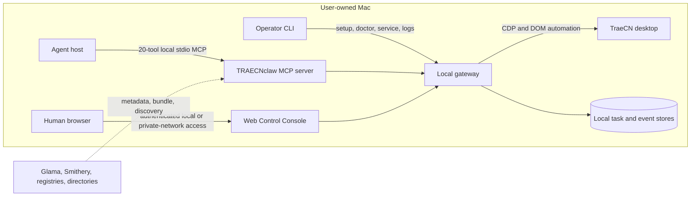

# TRAECNclaw 0.6.0 Launch Kit

This is prepared source material, not proof that a video or post is public.
Replace every `<verified-...>` placeholder only after the corresponding channel
row in `CHANNEL-LEDGER.md` is verified.

## Product sentence

TRAECNclaw gives agents and people one durable local gateway for operating and
observing coding tasks in the TraeCN desktop app running on the user's own Mac.

## Architecture and trust boundary

Marketplace containers can inspect metadata and schemas. They are outside the
runtime trust boundary and cannot transparently control the user's local Mac.

## Three demonstrable use cases

### 1. Delegate a coding task without holding the caller context

The agent opens or selects the intended workspace, chooses a model only when
needed, sends one coding instruction, receives a durable task identity, and is
free to continue other work. The gateway owns queue waiting and completion.

Evidence to capture: tool names, returned task ID, task status transition, final
result, and the matching visible TraeCN conversation.

### 2. Recover after a gateway or host restart

A task accepted durably before restart remains discoverable. The client can
query the exact task and receive its retained terminal result without
resubmitting the same work.

Evidence to capture: stable task ID before/after restart, service status, and
one terminal result with no duplicate TraeCN submission.

### 3. Resolve an exceptional interaction explicitly

Routine questions remain gateway-managed. When TraeCN presents a real approval
or user question, the agent receives a focused interaction intent and resolves
it through `traecn_decide_approval` or `traecn_answer_question`.

Evidence to capture: visible dialog, structured prompt, explicit decision, and
return to normal task flow. Never approve destructive work in a demo.

## Limitation card

> **Runs locally, not in the cloud.** TRAECNclaw operates TraeCN on the same
> user-owned Mac. Release testing uses Node.js 22 and verified adapter evidence
> covers TraeCN 1.107.x on macOS. The MCP transport is local stdio; remote human
> Web access requires authentication and a deliberately trusted network path.
> Directory listings and inspection containers are discovery surfaces, not
> hosted TraeCN control. Contract v5 contains exactly 20 tools.

## 60–90 second demo shot list

Target duration: 75 seconds. Record a fresh 0.6.0 installation; do not splice in
old-version footage.

1. **0–8 s — premise:** TraeCN and the MCP host visible on one Mac; overlay
   “local stdio · 20 focused tools · durable tasks”.
2. **8–20 s — verified install:** show the public Release or scoped npm command,
   then `traecn-mcp doctor` with secrets and personal paths cropped.
3. **20–30 s — discovery:** MCP host lists 20 tools; briefly show first
   `traecn_send_message` and last `traecn_decide_approval`.
4. **30–52 s — task:** use the Web Control Console to send a harmless task in a
   disposable sample workspace; show the exact task ID and TraeCN receiving the
   instruction.
5. **52–65 s — durability:** switch away while the gateway waits, then return to
   the completed task/result without a second submission.
6. **65–75 s — close:** show public repository, exact limitation card, and one
   verified install URL.

Acceptance before export:

- terminal, notifications, browser tabs, and TraeCN reveal no tokens, email,
  private repository content, or unrelated user data;
- version 0.6.0 and public URL are readable;
- recording shows the real host and task, not mock bridge output;
- audio/video decode scan passes and no unexplained black segment remains;
- captions do not say “hosted”, “cross-platform”, or imply untested versions.

## Five-minute tutorial script

### 0:00–0:35 — What it is

Explain the local trust boundary and distinguish the MCP Skill, server, gateway,
CLI, and Web Control Console. State macOS, TraeCN, and Node.js 22 requirements.

### 0:35–1:25 — Install

Use one verified server path—scoped npm or Homebrew—and install the Agent Skill
from the public mirror. Show exact versions. Do not use the historical unscoped
npm package.

### 1:25–2:05 — Prepare TraeCN

Run `traecn-mcp doctor`, explain the CDP requirement, and use Quickstart against
the existing logged-in profile. Keep the gateway on loopback for the demo.

### 2:05–2:45 — Connect the MCP host

Run `traecn-mcp setup-mcp`, merge the generated entry into the chosen host, and
restart/reconnect it. Show exactly 20 tools.

### 2:45–3:50 — Run one task

Select the disposable workspace, send one bounded coding instruction, show the
returned task ID, and explain why the caller does not poll or implement queue
recovery itself.

### 3:50–4:30 — Inspect and recover

Show service status, the task result, and one restart/reconnect path. Explain
that task identity and retained results belong to the gateway.

### 4:30–5:00 — Limits and next step

Display the limitation card, public Release, documentation, and feedback link.
Invite issue reports with TraeCN version and sanitized doctor output.

## Chinese launch draft

> TRAECNclaw 0.6.0：让 MCP Agent 和你本人在自己的 Mac 上操作 TraeCN。
>
> 它不是云端代跑服务，而是一套本地优先的 MCP Server + Agent Skill：20
> 个单一意图工具负责工作区、模型、模式、会话、任务和异常交互；队列等待、
> 持久化、重启恢复与完成通知统一交给本地 gateway。
>
> 本次发行加入了同一 gateway 驱动的 Web Control Console：可查看就绪状态、
> 工作区上下文、任务进度、异常交互、审查结果和高级诊断；连接 token 仅保留
> 在浏览器会话中。当前验证边界是 macOS、Node.js 22、TraeCN 1.107.x，本地
> stdio 运行；目录扫描容器不能远程接管你的 Mac。
>
> 安装与限制：<verified-release-url>
> 演示：<verified-demo-url>
> 欢迎提交真实环境反馈：请附 TraeCN 版本与脱敏后的 doctor 输出。

## Global launch draft

> TRAECNclaw 0.6.0 connects MCP-capable agents and one Web Control Console to
> TraeCN running on your own Mac. Its 20-tool, single-intent Agent surface and
> human console share one local gateway that owns queues, persistence,
> recovery, approvals, and completion delivery.
>
> This is a local stdio product—not a hosted cloud bridge. The verified release
> boundary is macOS, Node.js 22, and TraeCN 1.107.x. Version 0.6.0 adds the
> responsive Web Control Console with session-only authentication, exact task
> identity, event-first progress, reviews, and Advanced diagnostics.
>
> Install and limitations: <verified-release-url>
> Demo: <verified-demo-url>
> Feedback is welcome; include your TraeCN version and sanitized doctor output.

## Final publication checklist

- All placeholders replaced with verified public URLs.
- Channel ledger and public page agree on version, package, platform, transport,
  and 20-tool count.
- Demo and tutorial passed privacy and decode review.
- Exact post text and media reviewed at action time.
- Public post links tested while logged out.
- No request for coordinated stars, votes, or misleading popularity signals.
